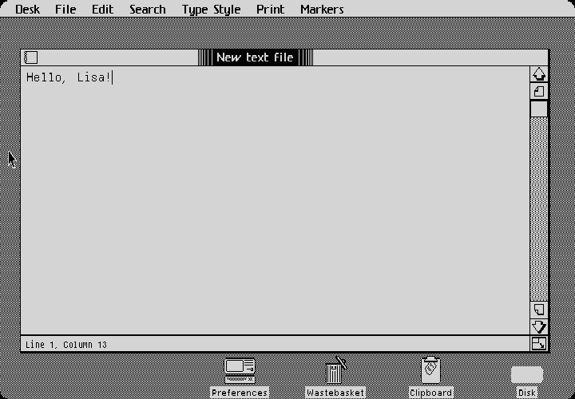

# Text Editor for the Lisa Office System

A text editor application for Apple Lisa Office System (LOS 3.1), similar to the one found in Lisa Workshop.
It edits Lisa text files (`.TEXT`).

Apple chose to have their text editor app only in Workshop (the Lisa Office System development environment).
Now you can edit them directly in Lisa Office System with this app.

Lisa Office System and the Workshop development environment share the same file system at startup: 
there is a "dual boot" dialog named the "Environments Selector", where you can choose which environment to start.
This means that if you edit a text file in Workshop, you can "see" the changes in LOS, and vice versa.

Note: the "Environments Selector" is available only if both LOS and Workshop are installed on the same ProFile hard disk,
and only if a "default environment" has not been chosen in that dialog. 
If the "Environments Selector" does not show up at boot time,
press any key when the Lisa starts booting up (after the BIOS startup screen).

The Text Editor running in Lisa Office System:

## Contents

- [Installing](#installing)
- [Starting the Text Editor](#starting-the-text-editor)
- [The window](#the-window)
- [Typing and moving around](#typing-and-moving-around)
- [Selecting with the mouse](#selecting-with-the-mouse)
- [The dialog bar](#the-dialog-bar)
- [Menus](#menus): [File](#file) · [Edit](#edit) · [Search](#search) · [Type Style](#type-style) ·
  [Print](#print) · [Markers](#markers)
- [What is kept, and when](#what-is-kept-and-when)
- [Limits](#limits)

## Installing

The DC42 floppy disk image file [`LosTextEditor.dc42`](LosTextEditor.dc42) contains the
text editor app. Boot into Lisa Office System (LOS 3.1) then insert ("mount") that
disk image, e.g. using a FloppyEmu or ESFloppy floppy disk hardware
emulator on a real Lisa, or in the [LisaEm](https://lisaem.sunder.net/) emulator, from the **File -> Insert Diskette** menu item.
Open the floppy disk icon; you will see the "Text Editor" app  icon in there. Figure out how to copy it
to your ProFile hard drive, or launch it from the floppy disk.

## Starting the Text Editor

Open the **Text Editor** icon on the desktop by double0clicking on it or select the icon with your mouse and then choose the File/Print->Open Text Editor menu.

Upon start, the editor pops a prompt under the menu bar: `Open text file named ?`

- Type a file name and press **Return** to open it.
- Or simply **click in the editor window**: the prompt goes away and you can start typing a text into a new file.

If you set the editor aside with unsaved work, it comes back exactly as you left it (see
[What is kept, and when](#what-is-kept-and-when)).

## The window

- **Title bar:** the name of the open `.TEXT` file, or **New text file** for a text that has not been
  saved to a file yet.
- **Scroll bar** on the right: arrows scroll line by line, the gray area page by page, and the box can
  be dragged.
- **Size box** in the bottom-right corner: drag it to make the window bigger or smaller.
- **Status line** along the bottom: where the insertion point is, e.g. `Line 12, Column 5`, or both
  ends of the selection, e.g. `Line 3, Column 1   to   Line 7, Column 12`.
- **Line numbers** in a left margin, if switched on with *Edit → Show Line Numbers*.

## Typing and moving around

| Key | Effect |
|---|---|
| any character | typed at the insertion point; typing replaces a selection |
| **Backspace** | deletes the character before the insertion point (or the selection) |
| **Return** | new line, indented like the line it came from |
| **Enter** | new line without indentation |
| **Tab** | spaces up to the next tab stop (see *Edit → Set Tabs*) |
| **← → ↑ ↓** | move the insertion point |
| **Shift** + arrow | extend the selection |
| **Apple** + ← / → | to the start / end of the line |
| **Apple** + ↑ / ↓ | to the start / end of the text |
| **Apple** + letter | the menu command with that letter (shown in the menus) |

## Selecting with the mouse

- **Click** to place the insertion point.
- **Drag** to select; dragging above or below the window scrolls it.
- **Double-click** to select a word, **triple-click** to select a line; keep the button down and drag to
  extend by words or lines.
- **Shift-click** to extend the current selection to the click.
- Clicking in the line-number margin goes to the start of that line.

## The dialog bar

Questions and messages appear in a bar under the menu bar.

- **Questions with a default** show it in brackets, e.g. `Go to which line ? [12]`. Press **Return** to
  accept the default, or type something else and press Return.
- **Clear** (Escape) cancels a question.
- **Yes/No questions** take **Y** or **N**; clicking anywhere else cancels.
- **Messages** wait for the **Space** bar.

## Menus

### File

| Item | Key | What it does |
|---|---|---|
| Set Aside Everything | | Sets aside all open windows on the desktop. |
| Set Aside "Text Editor" | | Sets the Text Editor aside. Your text, including unsaved changes, is kept and comes back when you open the Text Editor again. |
| Save & Put Away | | Same as *Exit Editor*. |
| New Text File | | Starts a new, empty text. Asks first if the current text has unsaved changes. |
| Open Text File ... | Apple-O | Opens a `.TEXT` file (the `.TEXT` ending is added if you leave it out). Asks first if the current text has unsaved changes. The file opens where you were when it was last saved: same scroll position and selection, with its tab setting, type style and markers. |
| Save Text File | | Saves to the open file; for a new text, asks for a file name. |
| Save Text File As ... | | Saves under a new name; asks before replacing an existing file. |
| Revert to Saved Text File | | Throws away all changes since the file was last saved, after asking. |
| Exit Editor | Apple-Q | Puts the Text Editor away. If there are unsaved changes it asks first: **Y** saves them (for a new text it asks for a file name), **N** throws them away, and clicking elsewhere cancels the exit. |

### Edit

| Item | Key | What it does |
|---|---|---|
| Undo Last Change | | Undoes the last command. Choosing it again redoes the command. |
| Cut | Apple-X | Removes the selection and keeps it on the clipboard. |
| Copy | Apple-C | Copies the selection to the clipboard. |
| Paste | Apple-V | Puts the clipboard contents at the insertion point, replacing a selection. |
| Shift Left | Apple-L | Removes one space from the start of every selected line that begins with a space. |
| Shift Right | Apple-R | Adds one space to the start of every selected line. |
| Set Tabs ... | | How many spaces a Tab stands for (1 to 30; normally 8). |
| Select All | Apple-A | Selects the whole text. |
| Show Line Numbers | | Shows or hides line numbers in a left margin (check-marked when on). The margin is just wide enough for the largest number on the screen. |

The clipboard belongs to the Text Editor: text cut or copied here cannot be pasted into other Office
System tools, and the other way round.

Undo works for typing, Cut, Copy, Paste, Shift Left/Right, Set Tabs, Select All, finding, the search
switches, Go to Line, Show Insertion Point, Go to Marker and type style changes.

### Search

| Item | Key | What it does |
|---|---|---|
| Find ... | Apple-F | Asks what to find (the selected text is offered) and selects the next occurrence after the selection. |
| Find Same | Apple-S | Finds the next occurrence of the same text again. |
| Find & Paste All ... | | Replaces every occurrence of the text being found with the clipboard contents. It asks *Verify each substitution?*: answer **Y** to be asked **Y**es / **N**o / **S**top at each one, or **N** to replace all at once (Apple-period stops). **This cannot be undone.** |
| Whole Words Only | | When checked, finds only whole words, e.g. `line` does not find `outline`. A word of 8 or more letters also finds longer words that start with it. |
| Match Case | | When checked, upper and lower case must match. |
| Wrap Around | | When checked (the normal setting), searching continues from the top after the end of the text. |
| Go to Line ... | Apple-G | Moves to the start of a line number you type. |
| Show Insertion Point | | Scrolls the window to the insertion point. |

### Type Style

The type style applies to the whole text and is saved in the `.TEXT` file.

| Item | What it is |
|---|---|
| Modern | a plain sans-serif typeface |
| Classic | a serif typeface |
| 20 Pitch (8 Point) | small, fixed-width (Modern only) |
| 15 Pitch (8 Point) | 15 characters per inch, fixed-width (Modern only) |
| 12 Pitch (10 Point) | 12 characters per inch, fixed-width (the normal setting) |
| 10 Pitch (12 Point) | 10 characters per inch, fixed-width |
| Proportional (12 Point) | letters of different widths |
| Proportional (18 Point) | larger, letters of different widths |

In a fixed-width ("pitch") size every character has the same width, so columns line up. At 20 and 15
pitch only the Modern typeface exists; choosing Classic there makes no difference.

### Print

| Item | Key | What it does |
|---|---|---|
| Format for Printer ... | | Chooses the printer, the paper and the orientation. |
| Print ... | Apple-P | Prints the whole text; asks for the number of copies and, if you like, a range of pages. |
| Print Selection ... | | Prints the lines the selection touches. |
| Monitor the Printer ... | | Shows the Office System's print queue. |

Pages have half-inch margins where the paper allows, and a footer with the file name (or "New text
file") and the page number. Long lines are cut off at the right edge of the paper; they are not
wrapped.

### Markers

A marker is a named, remembered selection: a quick way to jump between places in a long text.

| Item | Key | What it does |
|---|---|---|
| Set Marker ... | | Gives the current selection a name (up to 14 characters; the selected text is offered). Using an existing name moves that marker to the selection. Up to 18 markers. |
| Delete Marker ... | | Deletes a marker by name (the marker of the current selection is offered). |
| Go to Marker ... | Apple-M | Selects a marked place. The question lists all markers; pressing **Return** goes to the next marker after the insertion point, so Apple-M, Return, Apple-M, Return ... walks through them in order. Can be undone. |

Markers stay with their text while you edit. A marker whose text is cut away is deleted, and you are
told so. Markers are saved in the `.TEXT` file and are understood by the Lisa Workshop as well.

## What is kept, and when

The Text Editor keeps a working copy of your text, separate from your `.TEXT` files:

- **Set Aside** keeps everything, including unsaved changes; opening the Text Editor again brings it
  back, even after the Lisa has been turned off.
- **Exit Editor / Save & Put Away** ask about unsaved changes first. After saving (Y) or throwing them
  away (N), the next start begins with a fresh text and the *Open text file* question.
- When the Text Editor opens, it brings the last text back only if that text holds work that would
  otherwise be lost: unsaved changes, or a new text never saved to a file. A text that is safely saved
  in its `.TEXT` file is not reopened; open it again by name.

The setting of *Show Line Numbers* is not kept; it starts off each time.

## Limits

- A line can hold at most 255 characters. Commands that would make a longer line stop with the
  message *Line would be too long*.
- Text is not wrapped: each line is shown and printed as one line.
- A text can have up to 32767 lines.
- The clipboard is private to the Text Editor (see [Edit](#edit)).
- Printing follows the Office System's printing rules but has not been tried on a real printer yet.

## Disclaimer

I used AI in this project, to write most of the code and parts of this doc.

## License

Published under the [GNU General Public License v3.0](LICENSE).